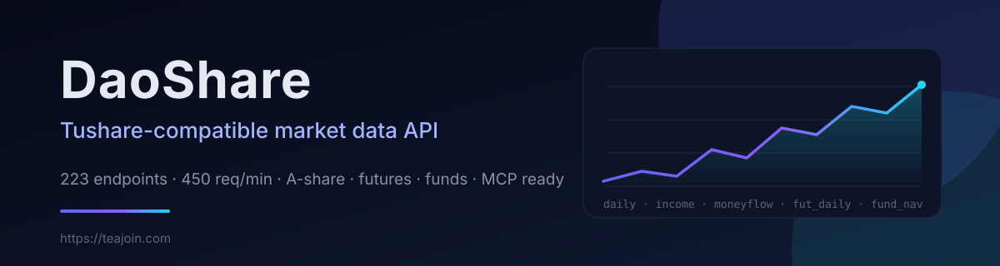

<p align="center">
  
</p>

<h1 align="center">DaoShare · Tushare 兼容行情数据 API</h1>

<p align="center">
  <a href="https://teajoin.com/guide"></a>
  
  
  
</p>

> 把请求地址改成 `https://teajoin.com`，你现有的 Tushare 代码就能直接跑。

---

## 这是什么

DaoShare 是一套兼容 Tushare Pro 协议的行情数据接口，覆盖 A 股、ETF、指数、基金、期货、期权、财务、资金流与特色数据。字段命名、参数、返回结构都与 Tushare 保持一致：

```json
{
  "request_id": "...",
  "code": 0,
  "msg": "",
  "data": {
    "fields": ["ts_code", "trade_date", "close"],
    "items": [["000001.SZ", "20260105", 11.2]],
    "has_more": false
  }
}
```

- **不用改代码**：Tushare SDK 只改 `http_url`，HTTP 调用只改域名。
- **223 个接口**：日/周/月线、财务三表、资金流、龙虎榜、涨跌停、同花顺热点、筹码分布、量化因子等。
- **AI 可直接接**：内置 MCP 端点，Claude / Cursor / Codex 配一行即可查数据。
- **限流明确**：单 Key 最高 450 次/分钟，建议请求间隔不低于 0.2 秒。

## 快速开始

### 1. 获取 API Key

打开 <https://teajoin.com/redeem> 输入兑换码，返回 `api_key` 和到期时间。兑换码可重复使用，忘记 Key 时重新输入同一兑换码即可找回。

```json
{"api_key": "YOUR_API_KEY", "expires_at": "2027-01-15 16:38:26"}
```

### 2. Python（Tushare SDK）

```python
import tushare as ts

# 同一个 Key：set_token 设全局，pro_api() 建实例后再同步一次
ts.set_token("YOUR_API_KEY")
pro = ts.pro_api()
pro._DataApi_token = "YOUR_API_KEY"
pro._DataApi__http_url = "https://teajoin.com"

df = pro.daily(ts_code="000001.SZ", start_date="20260101", end_date="20260131")
print(df.head())
```

### 3. Python（直接 HTTP）

```python
import requests

resp = requests.post("https://teajoin.com", json={
    "api_name": "daily",
    "token": "YOUR_API_KEY",
    "params": {"ts_code": "000001.SZ", "start_date": "20260101", "end_date": "20260131"},
})
print(resp.json())
```

### 4. MCP（Claude / Cursor / Codex）

```json
{
  "mcpServers": {
    "tushare": { "url": "https://teajoin.com/mcp/?api_key=YOUR_API_KEY" }
  }
}
```

配好后直接问：「查一下 000001.SZ 最近一周的日线行情」。

更多示例见 [examples/](examples/)。

## 接口覆盖

| 分类 | 代表接口 |
|---|---|
| 股票行情 | `daily` `weekly` `monthly` `daily_basic` `adj_factor` `stk_limit` `suspend_d` |
| 财务数据 | `income` `balancesheet` `cashflow` `fina_indicator` `forecast` `express` `dividend` |
| 资金与情绪 | `moneyflow` `moneyflow_hsgt` `hsgt_top10` `limit_list_d` `top_list` `top_inst` |
| 指数与板块 | `index_daily` `index_weight` `index_classify` `sw_daily` `ths_index` `ths_member` |
| 基金与 ETF | `fund_basic` `fund_nav` `fund_daily` `fund_portfolio` `etf_basic` `etf_share_size` |
| 期货与期权 | `fut_basic` `fut_daily` `fut_holding` `fut_wsr` `opt_basic` `opt_daily` |
| 特色数据 | `dc_hot` `ths_hot` `cyq_chips` `stk_factor_pro` `report_rc` `broker_recommend` |

完整的 223 个接口见 [docs/endpoints.md](docs/endpoints.md)，参数与返回字段以[官方文档](https://teajoin.com/guide)为准。

## 额度与限制

| 项 | 说明 |
|---|---|
| 通用套餐 | 15000 积分权限，覆盖常用股票、ETF、指数、基金、期货、期权、财务、资金流与特色数据 |
| 调用频率 | 最高 **450 次/分钟**，建议请求间隔 ≥ 0.2 秒 |
| 分钟数据 | 历史分钟与实时行情需单独开通，通用套餐默认不含 |
| 空结果 | 该日期没有数据时返回空 `items`，不是错误 |
| 返回格式 | `{"request_id", "code", "msg", "data": {"fields", "items", "has_more"}}` |

## 常见问题

**Key 过期了怎么办？**  
买新兑换码后到 <https://teajoin.com/redeem> 选「续费」，填原 Key + 新码。Key 不变，天数叠加；有效期内只能平级或升级。

**为什么返回 429？**  
触发了频率限制，或同一 IP 短时间失败次数过多。等待几分钟会自动恢复。

**财务三表为什么同一报告期有多行？**  
`report_type` 默认 `1`（合并报表）。同一股票同一报告期可能有多个口径，按 `report_type` 区分；单季数据传 `2`，母公司口径传 `6`/`7`。

**支持哪些市场？**  
A 股、ETF、指数、基金、期货、期权、可转债、宏观经济为主；港股、美股、新闻研报等属于独立权限，需单独开通。

## 链接

- 官网与文档：<https://teajoin.com/guide>
- 兑换与续费：<https://teajoin.com/redeem>
- 示例代码：[examples/](examples/)

## 免责声明

本项目仅用于数据接口的说明与示例。所有数据仅供学习研究，不构成任何投资建议。

## License

示例代码采用 MIT；文档与品牌内容版权归 DaoShare 所有。
